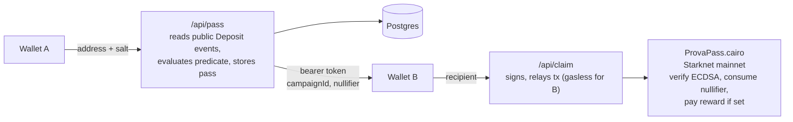

<div align="center">

# Prova Pass

**Turn provable STRK20 pool activity into a one-time capability that any other wallet can redeem, with gas sponsored and no on-chain link back to the wallet that qualified.**

[Live demo](https://provah.vercel.app/) · [Contract on Starkscan](https://starkscan.co/contract/0x74614e0cd54af7e59987a5d74fdd028209feff01fc20eca2934fe80b94db402) · [Demo video](https://x.com/levithefirst/status/2093702890044952686) · [`strk20.json`](strk20.json)

[](LICENSE)
[](https://starkscan.co/contract/0x74614e0cd54af7e59987a5d74fdd028209feff01fc20eca2934fe80b94db402)
[](https://github.com/starkience/strk20-hackathon)

</div>

---

Prova Pass is a capability layer. It takes a fact that can be proven about a wallet's **public** STRK20 pool activity, such as a holding period, a deposit total or a number of deposits. It then turns that fact into a bearer token. The token can be copied, sent in a DM or shown as a QR code, and it can be redeemed exactly once by a *different* wallet. That wallet can be brand new and empty.

The `ProvaPass` Cairo contract never inspects the predicate. It only checks that Prova's attester signed `(campaign_id, nullifier, recipient)`. It consumes the nullifier, and it can pay out an ERC20 reward in the same transaction.

Built for the [STRK20 Private Sprint](https://github.com/starkience/strk20-hackathon) against the live mainnet privacy pool at `0x040337b1af3c663e86e333bab5a4b28da8d4652a15a69beee2b677776ffe812a`.

> [!IMPORTANT]
> **The predicate check is a signed server attestation, not a zero-knowledge proof.** Whoever holds the attester key (today, only Prova) could sign a pass for a predicate that does not hold. The rest is enforced on-chain or can be checked by anyone: replay protection, binding to a campaign and recipient, and payout limits. See [Trust model](#trust-model) for exactly what is and isn't private.

## Contents

- [Try it](#try-it)
- [How it works](#how-it-works)
- [Live campaigns](#live-campaigns)
- [Trust model](#trust-model)
- [Verify a claim yourself](#verify-a-claim-yourself)
- [Architecture](#architecture)
- [Running locally](#running-locally)
- [Mainnet admin actions](#mainnet-admin-actions)
- [On-chain record](#on-chain-record)
- [Known limitations](#known-limitations)
- [License and credits](#license-and-credits)

## Try it

Prova only **reads** a wallet's existing public STRK20 deposit history. It cannot deposit into the pool or shield funds for you: the mainnet prover endpoint the pool requires is unpublished (see [The prover gap](#the-prover-gap)).

**Path 1: no deposit needed (about 2 minutes)**

1. Open [provah.vercel.app](https://provah.vercel.app/) and pick **Capability Smoke Test**. It is the default for first-time visitors and is satisfied by any address.
2. Connect **wallet A** and click **Generate pass**.
3. Connect **wallet B** (any other wallet, even one with no funds) and click **Claim**. Prova's operating account pays the gas.
4. Click **Verify on-chain**. This reads `is_nullifier_consumed` directly from public RPC, without going through Prova's backend.

**Path 2: a real predicate, optionally with a reward**

1. Shield some STRK into the STRK20 pool once, using a privacy-enabled wallet (Ready or Braavos).
2. Pick a real campaign and connect wallet A. The browser runs its own eligibility check against public RPC before anything is sent to the server.
3. Generate the pass, then claim it from wallet B. You can also paste a token into **Redeem a pass someone gave you**.
4. Optionally tick **Lock this pass to one destination wallet** before generating. `/api/claim` then refuses any other recipient with `403` before signing.

If a wallet doesn't qualify for a real campaign, the app shows instructions and a link back to the smoke test.

## How it works

1. **Campaign.** An operator creates a campaign on `ProvaPass` with `create_campaign`. The predicate type and claim kind live in the backend, so adding a campaign never needs a contract redeploy.
2. **Pass.** `/api/pass` reads the pool's public `Deposit` events for the caller's address and evaluates the predicate. If the predicate holds, it stores a pass bound to a fresh nullifier, `pedersen(campaign_id, prover_address, salt)`.
3. **Hand-off.** The pass token `(campaignId, nullifier)` is a bearer token. It is not tied to any wallet unless it was locked to one destination.
4. **Claim.** `/api/claim` signs `(campaign_id, nullifier, recipient)` with the attester key and relays `claim_with_prova_pass` from the operating account, so the claiming wallet needs no STRK.
5. **On-chain.** The contract checks the ECDSA signature, checks that the nullifier is unused and consumes it, and pays `reward_amount` of `reward_token` if the amount is above zero.

The chain only ever records `(campaign_id, nullifier, recipient, signature)`, so nothing on-chain links the recipient to the qualifying address.

### Predicate types

All three read the same public data, the pool's `Deposit` events, and aggregate it differently. They are implemented in [`src/lib/predicate.ts`](src/lib/predicate.ts).

| Predicate | Checks |
|---|---|
| `held_since` | Deposited ≥ X of asset Y in total, at least N days ago |
| `balance_threshold` | Deposited ≥ X of asset Y in total, at any time |
| `deposit_count` | Made ≥ N separate deposits of asset Y |

> [!NOTE]
> "In total" means **lifetime deposits**, not current balance. The pool's `Withdrawal` event encrypts the withdrawing user (`enc_user_addr`), so withdrawals can't be linked back to a depositor from public data.

### Claim kinds

- **`capability`**: the nullifier is consumed and nothing is transferred. Use it for allowlists or one-time actions.
- **`reward_token`**: the contract also transfers `reward_amount` of `reward_token` to the recipient. There is one entrypoint for both kinds; `reward_amount = 0` makes a claim capability-only.

### Issuance rules

- **Reward campaigns:** one pass per wallet. `/api/pass` stores a deterministic `address_commitment = pedersen(address, campaignId)` and returns `409` on a repeat. The code comments describe a unique index on `(campaign_id, address_commitment)` as a backstop, but the schema isn't in the repo.
- **Non-reward campaigns:** a wallet can generate any number of passes, each with its own nullifier.
- **All campaigns:** a nullifier can only ever be claimed once.

## Live campaigns

Five campaigns run on the single deployed contract. This list matches `GET https://provah.vercel.app/api/campaigns` and `strk20.json`.

| Campaign | Predicate | Claim kind |
|---|---|---|
| STRK Loyalty Drop | `held_since` (≥ 1 STRK in total, ≥ 7 days ago) | capability |
| STRK Holder Badge | `balance_threshold` (≥ 1 STRK in total) | capability |
| Active Depositor | `deposit_count` (≥ 1 deposit) | capability |
| STRK Welcome Reward | `balance_threshold` (≥ 1 STRK in total) | reward_token: **0.05 STRK** on redeem |
| Capability Smoke Test | `deposit_count`, minimum 0 (any address) | capability |

## Trust model

| | Status |
|---|---|
| Shielded balances and note-to-note transfers inside the pool | Private by the pool's own design. Prova doesn't touch them. |
| That a deposit happened, its amount, and the depositor's address | **Public.** The pool emits a public `Deposit` event, and Prova's predicates read only that. |
| The claim transaction and recipient | Public. They aren't linkable to the depositor on-chain, because the contract only sees `(campaign_id, nullifier, recipient, signature)`. |
| The predicate check | **A trusted server attestation.** This is the one real trust boundary (see below). |
| What Prova's server sees | The prover's address for the length of the `/api/pass` request. It stores one-way Pedersen commitments only, never the raw address ([`src/lib/attestation.ts`](src/lib/attestation.ts)). |

> [!WARNING]
> For **reward** campaigns, `address_commitment` has no salt, so the same wallet always maps to the same value. Anyone with **database access** could therefore check whether a candidate address already holds a pass for that campaign. This is a deliberate choice so that one wallet can't drain the reward pool. Non-reward campaigns never compute it.

**What limits a dishonest or compromised attester**

- The browser re-checks eligibility independently. `clientEvaluatePredicate` in [`src/app/ProvaApp.tsx`](src/app/ProvaApp.tsx) runs the same predicate maths against public RPC before `/api/pass` is called.
- A reward campaign can never pay out more than `ProvaPass` actually holds. Each reward campaign card reads that balance live.
- Every claim consumes a nullifier exactly once, and anyone can check this.

### The prover gap

Replacing the attestation with a client-side ZK proof needs STRK20's mainnet transaction prover (`starknet_proveTransaction`), and no public endpoint for it has been found. The hackathon repo has open issues from several teams asking for it: [#204](https://github.com/starkience/strk20-hackathon/issues/204), [#147](https://github.com/starkience/strk20-hackathon/issues/147) and [#121](https://github.com/starkience/strk20-hackathon/issues/121).

A hand-built `apply_actions` fee estimate for `EmitViewingKeySet` reverted with the pool's own `EMPTY_PROOF_FACTS` error. That confirms every pool state change needs proof artifacts. The full transcript is in the [archived build log](https://github.com/levithefirst/provah/blob/da59b87c444d857c1bca2dc3611f3303fa44e241/STATUS.md).

If a prover becomes reachable, the swap is backend-only:

- `ProvaPass.cairo` stays as it is.
- The `evaluatePredicate` functions in `src/lib/predicate.ts` are replaced.
- The bearer-token and nullifier mechanics stay the same.

## Verify a claim yourself

From the command line, using only public RPC (no Prova backend, database or secrets):

```sh
node scripts/verify-claim.mjs <nullifier>
# also confirm a reward payout:
node scripts/verify-claim.mjs <nullifier> <recipientAddress> <beforeBalanceWei>
```

Run `npm install` first, because the script imports `starknet`. The live app shows this exact command, with the real nullifier filled in, next to its **Verify on-chain** button.

In the browser, the app also:

- reads the recipient's STRK `balanceOf` before and after a reward claim and shows the difference
- shows how many passes have been claimed per campaign, from `ProvaPass`'s `PassClaimed` events

## Architecture



<details>
<summary>Text version</summary>


```
[Wallet A] --address+salt--> /api/pass --reads public Deposit events, evaluates predicate,
                                          derives nullifier, stores pass (Postgres)
                                  |
                                  v
                     bearer token (campaignId, nullifier)  -- copy / QR / DM
                                  |
[Wallet B] --recipient--------> /api/claim --signs (campaignId, nullifier, recipient),
                                             relays tx from the operating account (gasless for B)
                                  |
                                  v
                     ProvaPass.cairo (Starknet mainnet)
                       verify ECDSA -> consume nullifier -> pay reward if reward_amount > 0
```

</details>

| Path | What's there |
|---|---|
| [`contracts/prova_pass/`](contracts/prova_pass) | The `ProvaPass` Cairo contract (Scarb, `starknet = "2.9.2"`). Compiled Sierra and CASM files are vendored in [`src/contracts/`](src/contracts). |
| [`src/app/`](src/app) | Next.js 16 App Router UI. The main flow is in `ProvaApp.tsx`; the icon and OG image are generated in code. |
| [`src/app/api/`](src/app/api) | `campaigns`, `pass` and `claim`, plus `admin/deploy` and `admin/create-campaign`, which are gated by `PROVA_ADMIN_TOKEN`. |
| [`src/lib/`](src/lib) | Predicates, attestation, pass tokens, claim and pass decisions, the Starknet client and Postgres (`pg`). |
| [`vendor/`](vendor) | StarkWare's `@starkware-libs/starknet-privacy-sdk` and `starknet-privacy-client`, built from source and vendored. They are currently used for Pedersen, viewing-key and ECDSA primitives. |
| [`scripts/`](scripts) | `mainnet-admin.mjs` (operator CLI), `verify-claim.mjs`, and the `tsx` test scripts. |

## Running locally

**Requirements:** Node.js 22, which is what CI uses. You also need a Postgres database, a funded Starknet mainnet account to act as the operator, and an attester keypair.

```bash
npm install
cp .env.example .env.local
npm run dev        # http://localhost:3000
```

| Variable | Purpose |
|---|---|
| `STARKNET_RPC_URL` | Starknet mainnet RPC (the example uses public Lava RPC) |
| `STARKNET_CHAIN_ID` | `0x534e5f4d41494e` (`SN_MAIN`) |
| `STRK20_POOL_ADDRESS` | The STRK20 privacy pool contract |
| `STARKNET_ACCOUNT_ADDRESS`, `STARKNET_PRIVATE_KEY` | The operating account, which deploys contracts, creates campaigns and relays every claim. If either is missing, `/api/claim` returns `503 operator_not_configured`. |
| `PROVA_PASS_CONTRACT_ADDRESS`, `PROVA_PASS_CLASS_HASH` | Filled in after deploy |
| `PROVA_ATTESTER_PRIVATE_KEY`, `PROVA_ATTESTER_PUBLIC_KEY` | The attester keypair. The public key is baked into `ProvaPass` at deploy time. |
| `DATABASE_URL` | Postgres for campaigns, passes, claims and the activity log (public metadata only) |
| `PROVA_ADMIN_TOKEN` | Shared token for the `/api/admin/*` routes |

> [!NOTE]
> The repo doesn't include a SQL schema or migration for the Postgres tables (`campaigns`, `prova_passes`, `claims`, `mainnet_activity_log`). A fresh database has to be set up to match the queries in `src/lib/db.ts` and the API routes.

**Other commands**

```bash
npm test           # tsx test scripts: typed-data, ownership-fallback, predicate maths,
                   # pass token, pass and claim decisions, claim copy
npm run build      # next build
scarb build        # run from contracts/prova_pass/
```

## Mainnet admin actions

Real mainnet transactions run either from the deployed app or from the manual **Mainnet admin action** workflow ([`.github/workflows/mainnet-admin.yml`](.github/workflows/mainnet-admin.yml)). That workflow calls `scripts/mainnet-admin.mjs` on a GitHub-hosted runner, using repo secrets.

Its actions are:

- `deploy-account`, `deploy`
- `create-campaign`, `claim`, `fund-contract`
- `balance`, `check-owner`, `check-class`, `get-campaign`, `tx-status`
- `pool-abi`, `pool-register`
- `generate-attester-key`, `get-attester`, `set-attester`

They can also be run locally, with the environment variables exported:

```bash
node scripts/mainnet-admin.mjs deploy
node scripts/mainnet-admin.mjs create-campaign "STRK Loyalty Drop" \
  0x04718f5a0fc34cc1af16a1cdee98ffb20c31f5cd61d6ab07201858f4287c938d \
  1000000000000000000 7 "" "" "" held_since
```

> [!WARNING]
> These commands send real transactions on Starknet **mainnet** from the operating account, and they spend real STRK.

## On-chain record

`ProvaPass` is at [`0x74614e0cd54af7e59987a5d74fdd028209feff01fc20eca2934fe80b94db402`](https://starkscan.co/contract/0x74614e0cd54af7e59987a5d74fdd028209feff01fc20eca2934fe80b94db402), with class hash `0x7adfeaf0d075cda33b3128fd9cc255e34e7b778e907cbb64216d76bd7cf89e6`.

[`strk20.json`](strk20.json) records **15 mainnet transactions**: 11 involving `ProvaPass` and 4 made directly against the STRK20 pool.

<details>
<summary><b>ProvaPass transactions (11)</b></summary>

| # | Type | Tx |
|---|---|---|
| 1 | `deploy_account`: operating account | [`0x266ff3…c010`](https://starkscan.co/tx/0x266ff30feda87e59c13eeccf122af1d82aaf92088d95cf7dcbff91f44c3c010) |
| 2 | `declare`: ProvaPass class | [`0x1d57d6…1153`](https://starkscan.co/tx/0x1d57d647ff240ff4c02d9fb255bbaf80bc5238f8091483f33505c0ca3011153) |
| 3 | `deploy`: ProvaPass instance | [`0x79375d…c70a`](https://starkscan.co/tx/0x79375d773a91d5726a9bf896e114bc7549003f05c7decd685a0bce5b47dc70a) |
| 4 | `create_campaign`: STRK Loyalty Drop | [`0x758de9…26e6`](https://starkscan.co/tx/0x758de909a13df099cd72a1ef843217805d04ab761ab57e2bcd4c0f924c126e6) |
| 5 | `claim_with_prova_pass`: claim from a different wallet | [`0x5ebf46…9dce`](https://starkscan.co/tx/0x5ebf464f06bfe864f2ee875a4b8a84ab8032b31ced539300424067ae14f9dce) |
| 6 | `create_campaign`: STRK Holder Badge | [`0x41c168…e9b3`](https://starkscan.co/tx/0x41c16869dcd1f3781e839f44b9ea86b867d872f4177e7790fee631d957de9b3) |
| 7 | `create_campaign`: Active Depositor | [`0x12aa67…4496`](https://starkscan.co/tx/0x12aa67bcb97507d402cbe8a7308fd9a6c7ad3a9088227e4a35ad96603284496) |
| 8 | STRK `transfer`: fund ProvaPass with 1 STRK | [`0x76eeb4…7625`](https://starkscan.co/tx/0x76eeb4941bda080592816c3c51ca92da65c20de18c48e7d4782e90010927625) |
| 9 | `create_campaign`: STRK Welcome Reward | [`0x1a64f5…32c0`](https://starkscan.co/tx/0x1a64f5d8963b89118464d4613511b7f65eeb8ffb12f52df887e25404e5b32c0) |
| 10 | `claim_with_prova_pass`: 0.05 STRK payout to a brand-new address | [`0x45f6b0…514c`](https://starkscan.co/tx/0x45f6b0d60d1ef2b232885a416f562c16aea15365ea215efdd0db10c4da514c) |
| 11 | `create_campaign`: Capability Smoke Test | [`0x4e09d6…ffee`](https://starkscan.co/tx/0x4e09d659241d884664dcd3d7e12c4815463fd2b4242a51c9d13f7bc87a8ffee) |

Transaction 10 was triggered by the operator through `mainnet-admin.mjs` to test the payout end to end. The recipient's STRK balance went from `0` to `50000000000000000` wei (0.05 STRK).

</details>

<details>
<summary><b>Direct STRK20 pool transactions (4)</b></summary>

These four pool transactions were made by a person using a privacy-enabled wallet through the wallet-mediated route, not by Prova's backend. Each was checked with `scripts/mainnet-admin.mjs tx-status <hash>`: the pool contract emits `Deposit` (10 STRK) and `EncNoteCreated`, and the first one also emits `ViewingKeySet`.

- [`0x0684bdad…fc385`](https://voyager.online/tx/0x0684bdad671fb81afe3cc2c27038e867e352e3323f666e4fd967e0086fffc385): block 13929673, viewing-key registration plus a 10 STRK shield
- [`0x0043faa1…7adb6`](https://voyager.online/tx/0x0043faa1484457b0e5b97b860c5b9e1fdc6a5711dece60554bc8149b0b27adb6): block 13955923
- [`0x0613601d…04421`](https://voyager.online/tx/0x0613601df1f0057935ada6df4657962f853ba2b023e733886e2d3a5c95504421): block 13955965
- [`0x003c4835…dd9473`](https://voyager.online/tx/0x003c48357164e2536e57798787e9710b8025bdd4a083d10a5af2447e6fdd9473): block 13956048

Selector hashes and a note about an extra relay call that couldn't be decoded are in the [archived build log](https://github.com/levithefirst/provah/blob/da59b87c444d857c1bca2dc3611f3303fa44e241/STATUS.md).

</details>

## Known limitations

- **The predicate check is a trusted server attestation, not a zero-knowledge proof.** Whoever holds the attester key (today, only Prova) could sign a pass for a predicate that does not hold.
- **No public STRK20 mainnet prover was found** (`starknet_proveTransaction`), so the ZK swap described in [The prover gap](#the-prover-gap) is not done.
- **Reward-campaign commitments are unsalted**, so anyone with database access could check whether a known address already holds a pass for that campaign.
- **The database schema is not in the repo.** The code comments describe a unique index on `(campaign_id, address_commitment)` as a backstop, but it can't be checked from here.
- **Predicates read only public `Deposit` events**, not shielded balances.

## License and credits

Prova Pass is released under the MIT license; see [`LICENSE`](LICENSE).

The vendored packages under [`vendor/`](vendor) are StarkWare's `starknet-privacy` SDK and client. Each package keeps its own `LICENSE` file, which is Apache-2.0. Note that the `package.json` of each says `ISC`.

The STRK20 privacy pool is StarkWare's contract; Prova Pass only reads its public events.
